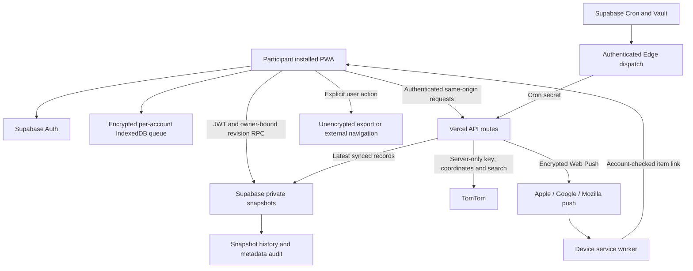

# DayBridge system architecture

> Production update, 2026-10-24: the owner approved release after backup checks. The security migration is applied and all 26 pre-existing public-table records were verified unchanged. See [release verification](PRODUCTION_RELEASE_2026-10-24.md) for current status; candidate-state statements below describe the original audit. Institutional enrollment remains subject to the listed gates.

Review date: 2026-10-23 (America/New_York). Candidate branch: `feat/daybridge-pilot-security-hardening`. This describes source plus a read-only production metadata audit. Candidate changes and the security migration have **not** been deployed. See [readiness](PILOT_TECHNICAL_READINESS.md) for release gates.

## Runtime and trust boundaries

Next.js 15.5.28 App Router and React 19 provide a responsive installed PWA. The public page mounts InstallGate, SecureAppGate, then a keyed DayBridgeProvider for one authenticated identity. There is no court-staff portal or participant-sharing role. Supabase Auth owns password hashing, sessions and authentication; the app never stores plaintext passwords. Vercel Node routes authenticate with `getUser()` before privileged operations. Supabase browser traffic uses the public project key and owner RLS; service credentials are confined to server modules.

The diagram shows processors, not a claim that vendors cannot access records. Infrastructure administrators and service credentials can access server records. No end-to-end encryption protects the cloud snapshot from its operator.

## Implemented product paths

| Area | Actual implementation | Material limit |
|---|---|---|
| Schedule | Event recurrence, timezone conversion, self-reported occurrence attendance | Attendance is not official verification; branch fixes distinct weekly occurrence identity |
| Tasks | Participant-owned lists, completion and subtasks | Whole-snapshot synchronization |
| Medication | Schedules, explicit Taken/Skip/Snooze, inventory estimate, archive/restore/delete | Self-report only; branch adds real undo, exact slot duplicate guard and inventory adjustment |
| Budget | Manual accounts, transactions, bills, reserves, paycheck estimates in integer cents | No bank integration; estimates depend on participant inputs |
| Map/travel | Real MapLibre 6 worker/WebGL2, TomTom raster/traffic/search/geocode/routing; trip inferred from calendar | Network/graphics/provider entitlement required; no static map or fabricated route |
| Notifications | Once-minute scheduler, separate reminder/travel pipelines, per-device provider receipts and bounded retries, item deep links | Provider acceptance is not display, acknowledgment or completion |
| PWA | App-shell cache, offline IndexedDB, update/version checks, installed-app gate | Physical iOS/Android/macOS acceptance remains open |
| Accounts | Supabase password sign-in; legacy username compatibility; experimental passkeys | Secure new username provisioning/recovery and administrative MFA need separate verification |

## Persistence and concurrency

The shipped UI uses one `public.private_snapshots` JSON object per `auth.users.id`; domain arrays include schedule, doses, budgets, contacts and saved places. Revision history captures previous changed payloads. The candidate wrapper `save_private_snapshot_for_user` binds a queued write to its originating account and delegates to the existing compare-and-swap RPC. Stale revisions preserve device edits and stop cloud overwrites. A lost successful response may require manual conflict recovery; this is safe rejection, not transparent automatic merging.

IndexedDB stores AES-256-GCM ciphertext, random IVs and per-account AAD. The non-extractable key resides in the same browser origin. XSS or an unlocked browser profile can use it. Dirty snapshots are a durable latest-state queue, not a per-operation event log. Deletions are absent entries in a newer snapshot, not independent tombstones. Cross-device automatic merge is intentionally unavailable; never resolve a conflict by blindly replacing a newer snapshot.

## Database/API inventory

The live metadata audit found 26 public tables, all RLS-enabled; no public views and no Storage buckets/policies. The candidate adds `private_security_audit` (27 tables when applied). The 16 unused normalized tables (`profiles`, `calendar_events`, `event_occurrences`, `tasks`, `medications`, `medication_schedules`, `medication_logs`, `budget_accounts`, `money_transactions`, `paycheck_plans`, `wage_advances`, `bills`, `budget_reserves`, `reminder_rules`, `reminder_occurrences`, `resource_contacts`) retain their data and RLS but lose browser grants in the candidate migration.

Active/support tables: `private_snapshots`, `private_snapshot_history`, `push_subscriptions`, `travel_preferences`, `travel_appointments`, `travel_estimates`, `notification_deliveries`, `notification_device_receipts`, `travel_request_limits`, `travel_api_limits`. Ownership predicates apply where browser reads/writes are intended; receipts, worker locks and rate counters are service-only. Review all migration files as the executable policy/function inventory.

Authenticated routes: travel route/geocode/places/tiles/overlays/push-test and notification device registration. Travel preferences and appointment persistence use authenticated owner-scoped database operations. Public version and branch liveness endpoints contain no records. The cron route requires a timing-safe secret comparison. Internal trigger functions use a fixed empty search path and revoked public execution. Service RPCs cannot be called by browser roles.

## Release topology

Production is the existing Git-integrated `main` deployment. This branch disables its own Vercel deployments. There is no provisioned staging project, new paid service or changed live credential. Test harness routes exist only during the test subprocess and are removed before the deployable build. Source/CI changes alone do not activate database controls.
